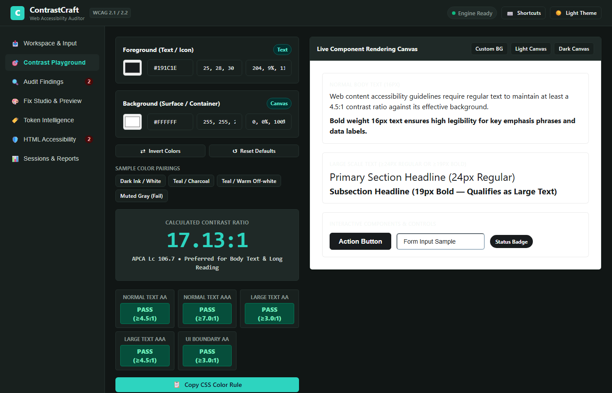
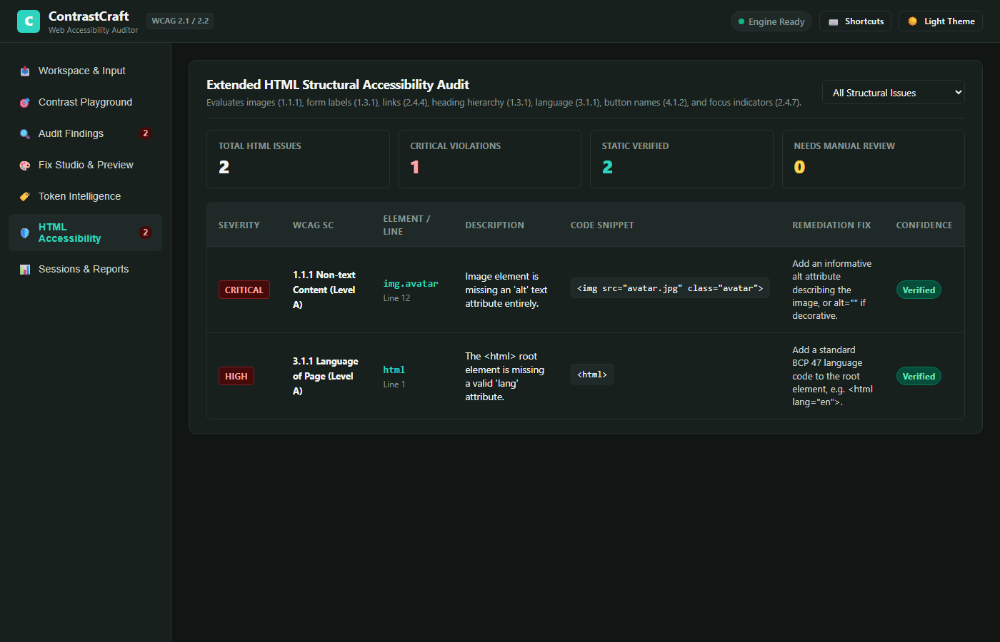

# ContrastCraft — Automated Web Accessibility Contrast Auditor

[](https://www.w3.org/WAI/standards-guidelines/wcag/)
[](https://pytest.org)
[](https://fastapi.tiangolo.com)
[](https://python.org)
[](#design-system--visual-identity)
[](LICENSE)
[](#security--privacy-considerations)

> **Day 10 of the 90 Days — 90 Projects Challenge**  
> An automated, local-first web accessibility contrast auditor, design token intelligence engine, and CSS remediation studio that performs exact mathematical WCAG relative luminance calculations, evaluates the CSS cascade, computes APCA readability metrics, simulates token cascade impact, and previews changes in an isolated sandboxed split preview.

---

## 1. Project Title & Description

**ContrastCraft** is a developer tooling platform designed to eliminate color-contrast and structural accessibility barriers in modern web applications. Built with a high-performance Python/FastAPI backend and an editorial, token-driven web workspace, ContrastCraft evaluates effective foreground and background colors through inheritance and alpha compositing, checks compliance against WCAG 2.1 & 2.2 Success Criteria, audits structural HTML accessibility issues, and guides developers through a non-destructive patch remediation workflow.

---

## 2. Problem Statement & Motivation

According to WebAIM's annual accessibility study of the top 1,000,000 websites, **low-contrast text remains the single most common accessibility violation on the web**, detected on over **81% of homepages**, alongside missing image alternatives and form label associations. 

Developers and design system maintainers struggle because:
- Design trends favor subtle, low-contrast typography and delicate gray borders that fail WCAG SC 1.4.3 and SC 1.4.11.
- Manual inspection in browser developer tools is slow, fragmented, and lacks cascade context.
- Brute-force fixers destroy brand identity by forcing all failing colors to pure `#000000` or `#FFFFFF`.
- CSS custom properties (`var(--token)`) create complex downstream dependencies where changing a token in one place can inadvertently break accessibility across multiple components.

ContrastCraft was engineered to solve this with **exact mathematical relative luminance calculations**, **APCA candidate scoring**, **hue-preserving lightness adjustments**, **pairwise design token matrix compatibility**, and **safe, reversible CSS patch generation**.

---

## 3. Design System & Visual Identity: Technical Editorial

ContrastCraft features a custom **Technical Editorial** visual language tailored for software engineers, accessibility specialists, and design system leads:

- **Light Theme:** Warm off-white canvas (`#FBFBFA`), crisp white elevated work surfaces (`#FFFFFF`), dark ink text (`#191C1E`, 15.8:1 AAA contrast), restrained teal accent (`#0D9488`), and fine neutral borders (`#E2E0D8`).
- **Dark Theme:** Deep charcoal canvas with a subtle green/teal undertone (`#111615`), elevated work surfaces (`#18201E`), comfortable light text (`#F0F4F2`, 14.2:1 AAA contrast), and vibrant teal accents (`#2DD4BF`).
- **Restrained Developer Workspace:** Compact left navigation, contextual findings inspector, unified diff viewer, interactive visual playground, and non-blocking toast notifications.

---

## 4. Key Features

### 🎯 Visual Contrast Playground
- **Live Color Space Synchronization:** Color picker with bi-directional syncing across HEX, RGB, and HSL values.
- **Dual Formula Evaluation:** Computes standard W3C relative luminance contrast ratio alongside Advanced Perceptual Contrast Algorithm (APCA $L_c$) scores.
- **Interactive Component Preview Board:** Evaluates regular body text (16px), bold body text (16px), large headlines (24px regular & 19px bold), form inputs with boundary borders, action buttons, and badges against customizable backgrounds.
- **Instant Actions:** Swap/invert colors (`⇄`), reset to editorial defaults, one-click CSS declaration copy, and preset palettes.

### 🔍 WCAG Contrast Audit & Cascade Resolver
- **Exact W3C Mathematical Engine:** Channel linearization and relative luminance:
  $$L = 0.2126 \times R_{\text{linear}} + 0.7152 \times G_{\text{linear}} + 0.0722 \times B_{\text{linear}}$$
  $$\text{Ratio} = \frac{L_1 + 0.05}{L_2 + 0.05}$$
- **Full Spectrum Color Parser:** Supports 3/4/6/8-digit Hex, RGB/RGBA (including CSS4 whitespace & slash syntax), HSL/HSLA, 148 W3C named colors, and CSS custom properties (`var(--token, fallback)`).
- **Cascade & Specificity Resolution:** Accurately calculates selector specificity tuples `(inline, id, class/attr, tag)` and traces upward through parent containers to resolve effective background colors.
- **Porter-Duff Alpha Compositing:** Accurately blends semi-transparent foregrounds over opaque backdrops.
- **Honest Confidence Categorization:** Distinguishes `verified` static findings from `needs_browser_verification` elements (gradients, background images).

### 🏷️ Design Token Intelligence & Compatibility Matrix
- **Pairwise Compatibility Matrix:** Computes an $N \times N$ matrix evaluating every token as foreground against every token as background, color-coding cells as AA Pass, UI-Only Pass, or Fail.
- **Duplicate Token Detection:** Detects tokens sharing identical color values to prevent design token drift and alias fragmentation.
- **Token Impact Simulator:** Select any CSS variable, specify a proposed color, and instantly calculate affected selectors, resolved failing usages, and net contrast gain.

### 🛡️ Extended HTML Structural Accessibility Auditor
- **Image Alternative Text (SC 1.1.1):** Identifies missing `alt` attributes and generic placeholder values (`image`, `photo`).
- **Form Control Labels (SC 1.3.1, 4.1.2):** Validates explicit `<label for="id">`, wrapped `<label>`, or `aria-label` attributes.
- **Link Context (SC 2.4.4):** Flags empty links and vague generic link text (`click here`, `read more`).
- **Heading Hierarchy (SC 1.3.1, 2.4.6):** Validates presence of `<h1>` and flags skipped heading levels (e.g., `<h2>` directly to `<h4>`).
- **Document Language (SC 3.1.1):** Ensures root `<html>` declares a valid BCP 47 `lang` attribute.
- **Button Accessible Names (SC 4.1.2):** Flags icon buttons lacking text, alt text, or `aria-label`.
- **Focus Outline Suppression (SC 2.4.7):** Detects `outline: none` in CSS focus rules lacking alternative focus indicators.

### 🎨 Fix Studio & Safe CSS Remediation
- **Hue-Preserving Lightness Search:** Identifies optimal lightness adjustments that satisfy WCAG AA or AAA while preserving the designer's intended hue.
- **Interactive Lightness Slider & Tuner:** Real-time slider adjusting lightness ($\Delta L$) with live preview.
- **Typography & Touch Sizing Strategies:** Promote elements to WCAG Large Text (lowering threshold to 3.0:1) or polish button touch targets (44px minimum touch target, 8px radius, 2px focus ring).
- **Accessible Theme Harmonizer:** Apply cohesive pre-tested accessible palettes (*Modern Tech Indigo*, *Emerald Fintech*, *Warm Editorial*, *Cyber Obsidian*) website-wide.
- **Safe Reversible Patches:** Generates unified diffs, creates `.bak` backups before modifying files, and provides an instant one-click **Revert Last Patch** action.

### 📊 Multi-Format Export & Local Persistence
- **Export Formats:** Standalone HTML audit reports, RFC 4180 compliant CSV logs, machine-readable JSON data, and unified `.diff` patch files.
- **SQLite Session Persistence:** Save, reopen, and track historical audit runs with compliance score metrics.
- **Multi-File Upload Queue:** Drag-and-drop or select multiple HTML and CSS files, preview file queue with sizes, remove individual items, and analyze in bulk.

---

## 5. Visual Screenshots

Real screenshots captured directly from the running ContrastCraft application:

| Workspace & Input Queue | Visual Contrast Playground |
| :---: | :---: |
|  |  |
| *Multi-file upload queue, paste editor, and folder scanner* | *Live APCA/WCAG calculator, color space sync, & preview board* |

| WCAG Findings & Inspector | Fix Studio & Live Split Preview |
| :---: | :---: |
|  |  |
| *WCAG classification, confidence badges, & selector inspector* | *Hue-preserving fixes, color tuner, & side-by-side iframe diff* |

| Token Intelligence & Matrix | HTML Structural Accessibility |
| :---: | :---: |
|  |  |
| *Pairwise compatibility matrix & token impact simulation* | *WCAG Level A & AA structural HTML accessibility findings* |

---

## 6. Architecture Overview

ContrastCraft adopts a clean, modular, local-first architecture:

```
[ Browser UI: Technical Editorial SPA ]
       │
       ▼ (REST API / JSON / Blob Downloads)
[ FastAPI Backend: app.py & backend/app/main.py ]
       ├── core/html_parser.py   --> DOM Tree Builder & Role Classifier
       ├── core/css_parser.py    --> Specificity & Cascade Resolver
       ├── core/colors.py        --> Parser & Porter-Duff Alpha Compositor
       ├── core/contrast.py      --> Exact W3C Relative Luminance & APCA Engine
       ├── core/classifier.py    --> WCAG 2.1/2.2 Criteria Classification
       ├── core/token_matrix.py  --> Pairwise Matrix & Token Impact Simulator
       ├── core/html_a11y.py     --> Structural HTML Accessibility Auditor
       ├── core/recommender.py   --> HSL Lightness Search & Theme Palettes
       ├── core/patcher.py       --> Unified Diff, Safe Application & Revert
       ├── core/reporter.py      --> Standalone HTML, CSV & JSON Generator
       └── database/session_store.py --> Local SQLite Session Persistence
```

For full architectural diagrams and data flows, see [docs/ARCHITECTURE.md](docs/ARCHITECTURE.md).

---

## 7. Technology Stack

- **Backend Runtime:** Python 3.10+ (tested on Python 3.14.7)
- **Web Framework:** FastAPI 0.162.0 & Starlette
- **ASGI Server:** Uvicorn 0.54.0
- **Data Validation:** Pydantic 2.14.1
- **Persistence:** SQLite 3 (Python standard library `sqlite3`)
- **Frontend:** Semantic HTML5, CSS3 Custom Properties (Design Tokens), Vanilla JavaScript (ES Modules)
- **Testing:** Pytest 9.1.1, HTTPX 0.28.1
- **Operating System:** Windows 10/11 (with automated `.bat` scripts)

---

## 8. Project Directory Structure

```
90-days-90-projects-day-10-contrastcraft/
├── app.py                     # Main application entry point
├── requirements.txt           # Python dependency manifest
├── pyproject.toml             # Project build configuration
├── setup.bat                  # Automated Windows environment installer
├── run.bat                    # Automated Windows application launcher
├── test.bat                   # Automated Windows pytest runner
├── QUICKSTART.md              # 60-second quickstart guide
├── DEMO_SCRIPT.md             # 90-second portfolio walkthrough script
├── LICENSE                    # MIT License
├── .gitignore                 # Git ignore configuration
├── .env.example               # Environment variables template
├── backend/
│   ├── app/
│   │   ├── main.py            # FastAPI setup & static mounts
│   │   ├── api/routes.py      # REST API endpoints
│   │   ├── core/              # Analysis, contrast, tokens, patcher & a11y engines
│   │   └── database/          # SQLite persistence store
│   └── tests/                 # 46 automated unit & integration tests
├── frontend/                  # Accessible Single Page Web Application
│   ├── index.html             # Technical Editorial accessible HTML5 interface
│   ├── css/                   # Design system tokens, main layout, components
│   └── js/                    # Application bundle with offline mathematical fallback
├── examples/                  # Clearly labeled showcase files with known pass/fail cases
│   ├── sample_portfolio.html
│   └── sample_styles.css
├── docs/                      # In-depth engineering documentation
├── scripts/                   # Automated screenshot capture & DOM test utilities
└── screenshots/               # Real application screenshots
```

---

## 9. Prerequisites

- **Operating System:** Windows 10/11 (macOS / Linux also supported)
- **Python:** Python 3.10 or newer (tested with Python 3.14.7)
- **Web Browser:** Any modern browser (Google Chrome, Microsoft Edge, Firefox)
- **Internet Connection:** Not required after initial installation (runs 100% offline).

---

## 10. Step-by-Step Windows Installation

### Option A: Automated Setup (Recommended)
Double-click `setup.bat` or run in PowerShell:
```powershell
.\setup.bat
```

### Option B: Manual Setup
```powershell
# 1. Open PowerShell and navigate to the project directory
cd "d:\90 days\90-days-90-projects-day-10-contrastcraft"

# 2. Create the virtual environment
py -m venv .venv

# 3. Activate the virtual environment
.\.venv\Scripts\Activate.ps1

# 4. Upgrade pip and install pinned requirements
python -m pip install --upgrade pip
pip install -r requirements.txt
```

---

## 11. Quick Start Commands

```powershell
# Launch the application (automatically opens http://127.0.0.1:8000)
.\run.bat

# Or run via Python directly:
python app.py --open

# Run all 46 automated unit and integration tests:
.\test.bat
```

---

## 12. Environment Variables & `.env.example`

ContrastCraft works out-of-the-box with sensible local defaults. To customize host or port, copy `.env.example` to `.env`:

```ini
HOST=127.0.0.1
PORT=8000
ENVIRONMENT=development
LOG_LEVEL=info
```

---

## 13. Testing Instructions & Actual Results

Run the complete automated test suite using `test.bat`:
```cmd
test.bat
```

### Actual Test Execution Output
```
=====================================================================
  Running ContrastCraft Automated Test Suite (pytest)
  Mathematical Accuracy, WCAG Criteria, Cascade, Diff and Safety Tests
=====================================================================

============================= test session starts =============================
platform win32 -- Python 3.14.7, pytest-9.1.1, pluggy-1.7.0
rootdir: d:\90 days\90-days-90-projects-day-10-contrastcraft
configfile: pyproject.toml
plugins: anyio-4.15.1
collected 46 items

backend/tests/test_api.py::test_api_health_direct PASSED                 [  2%]
backend/tests/test_api.py::test_api_presets_direct PASSED                [  4%]
backend/tests/test_api.py::test_api_audit_paste_valid_direct PASSED      [  6%]
backend/tests/test_api.py::test_api_recommend_direct PASSED              [  8%]
backend/tests/test_api.py::test_api_patch_lifecycle_direct PASSED        [ 10%]
backend/tests/test_api.py::test_api_session_lifecycle_direct PASSED      [ 13%]
backend/tests/test_classifier.py::test_large_text_evaluation PASSED      [ 15%]
backend/tests/test_classifier.py::test_normal_text_aa_and_aaa PASSED     [ 17%]
backend/tests/test_classifier.py::test_large_text_aa_and_aaa PASSED      [ 19%]
backend/tests/test_classifier.py::test_non_text_ui_component_boundary PASSED [ 21%]
backend/tests/test_colors.py::test_hex_parsing PASSED                    [ 23%]
backend/tests/test_colors.py::test_rgb_and_rgba_parsing PASSED           [ 26%]
backend/tests/test_colors.py::test_hsl_and_hsla_parsing PASSED           [ 28%]
backend/tests/test_colors.py::test_named_colors PASSED                   [ 30%]
backend/tests/test_colors.py::test_css_variables_and_fallbacks PASSED    [ 32%]
backend/tests/test_colors.py::test_alpha_compositing PASSED              [ 34%]
backend/tests/test_colors.py::test_unsupported_dynamic_indicators PASSED [ 36%]
backend/tests/test_contrast.py::test_channel_to_linear PASSED            [ 39%]
backend/tests/test_contrast.py::test_relative_luminance_extremes PASSED  [ 41%]
backend/tests/test_contrast.py::test_black_on_white_21_to_1 PASSED       [ 43%]
backend/tests/test_contrast.py::test_equal_colors_1_to_1 PASSED          [ 45%]
backend/tests/test_contrast.py::test_known_wcag_boundary PASSED          [ 47%]
backend/tests/test_contrast.py::test_apca_calculation PASSED             [ 50%]
backend/tests/test_html_a11y.py::test_html_missing_lang PASSED           [ 52%]
backend/tests/test_html_a11y.py::test_image_alt_detection PASSED         [ 54%]
backend/tests/test_html_a11y.py::test_form_label_associations PASSED     [ 56%]
backend/tests/test_html_a11y.py::test_empty_and_generic_links PASSED     [ 58%]
backend/tests/test_heading_hierarchy_skips PASSED                         [ 60%]
backend/tests/test_html_a11y.py::test_button_missing_accessible_name PASSED [ 63%]
backend/tests/test_html_a11y.py::test_css_focus_outline_suppression PASSED [ 65%]
backend/tests/test_parser.py::test_html_parsing_and_roles PASSED         [ 67%]
backend/tests/test_parser.py::test_specificity_calculation PASSED        [ 69%]
backend/tests/test_parser.py::test_css_cascade_and_inheritance PASSED    [ 71%]
backend/tests/test_patcher.py::test_targeted_css_patch_generation PASSED [ 73%]
backend/tests/test_patcher.py::test_safe_patch_application_safety PASSED [ 76%]
backend/tests/test_recommender.py::test_hue_preserving_lightness_adjustment PASSED [ 78%]
backend/tests/test_recommender.py::test_recommendation_api_structure PASSED [ 80%]
backend/tests/test_recommender.py::test_preset_palettes_available PASSED [ 82%]
backend/tests/test_reporter.py::test_json_report_generation PASSED       [ 84%]
backend/tests/test_reporter.py::test_html_report_escaping_and_structure PASSED [ 86%]
backend/tests/test_reporter.py::test_corrected_css_export PASSED         [ 89%]
backend/tests/test_reporter.py::test_csv_report_generation PASSED        [ 91%]
backend/tests/test_session_store.py::test_session_crud_and_comparison PASSED [ 93%]
backend/tests/test_token_matrix.py::test_token_matrix_generation PASSED  [ 95%]
backend/tests/test_token_matrix.py::test_duplicate_token_detection PASSED [ 97%]
backend/tests/test_token_matrix.py::test_token_impact_evaluation PASSED  [100%]

============================= 46 passed in 0.98s ==============================

[PASS] All automated tests passed successfully!
```

---

## 14. Keyboard Shortcuts

| Shortcut | Action |
| :--- | :--- |
| `Alt + A` | Run Accessibility Audit |
| `Alt + 1` | Switch to Workspace & Input Queue |
| `Alt + 2` | Switch to Visual Contrast Playground |
| `Alt + 3` | Switch to Audit Findings |
| `Alt + 4` | Switch to Fix Studio & Split Preview |
| `Alt + 5` | Switch to Design Token Intelligence & Matrix |
| `Alt + 6` | Switch to Structural HTML Accessibility |
| `Alt + 7` | Switch to Sessions & Reports |
| `Alt + T` | Toggle Dark / Light Theme |
| `Alt + S` | Focus Findings Search Input |
| `Escape` | Dismiss Modals & Inspector Drawer |
| `?` | Open Keyboard Shortcuts Help Reference |

---

## 15. Security & Privacy Considerations

- **100% Local Processing:** Source code, design tokens, and audit results never leave your machine.
- **Path Traversal Protection:** Directory scanning rejects attempts to escape the selected folder root.
- **No Unsafe Execution:** ContrastCraft statically parses CSS and HTML without spawning shell processes or executing user JavaScript on the server.
- **Strict Patch Confirmation & Reversion:** Files are never modified without explicit user authorization, and `.bak` backups are automatically created with one-click restore support.

---

## 16. Technical Skills & Resume Keywords

`Web Accessibility (a11y)` • `WCAG 2.1 / 2.2 Level AA & AAA` • `APCA (Advanced Perceptual Contrast Algorithm)` • `Relative Luminance` • `Design Tokens & Token Compatibility Matrix` • `FastAPI` • `Python 3.14` • `CSS Cascade & Specificity` • `Unified Diff Generation` • `Sandboxed Iframe Security` • `Pytest (46 Tests)` • `SQLite` • `Full-Stack Developer Tooling` • `Local-First Software Architecture`

---

## 17. License & Attribution

This project is licensed under the **MIT License** — see the [LICENSE](LICENSE) file for details.  
Created as part of the **90 Days — 90 Projects Challenge** by **Ragu Ram P**.
