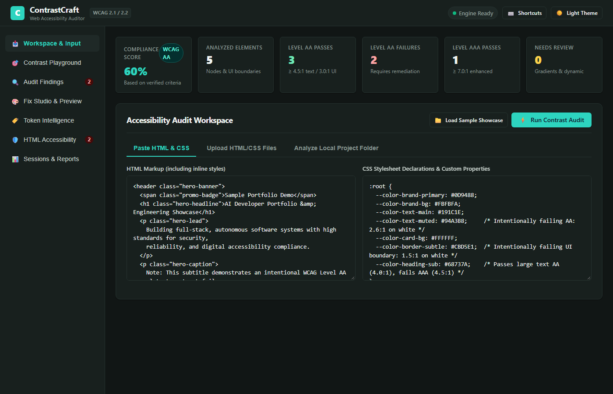
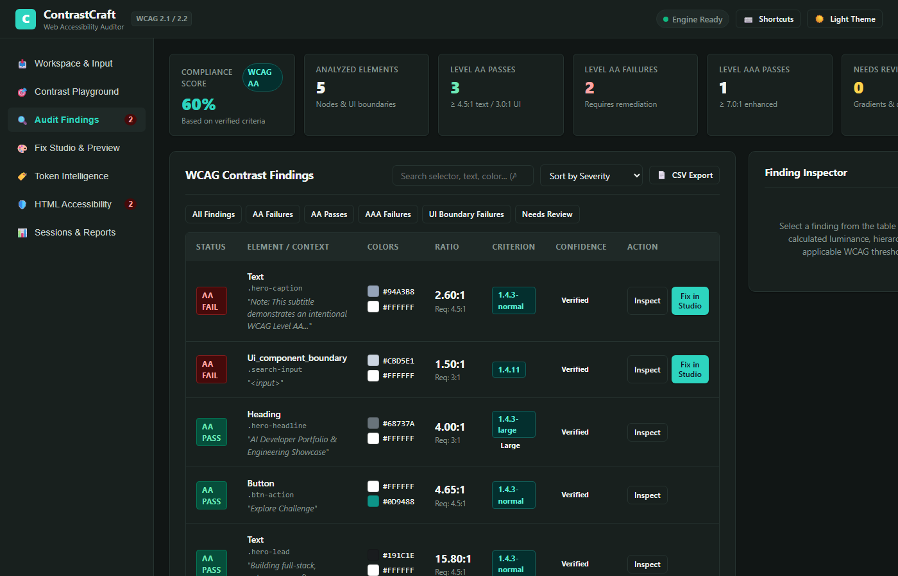
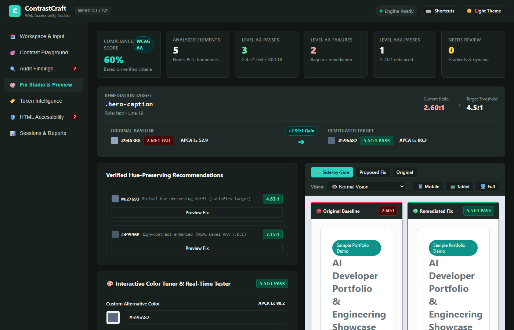
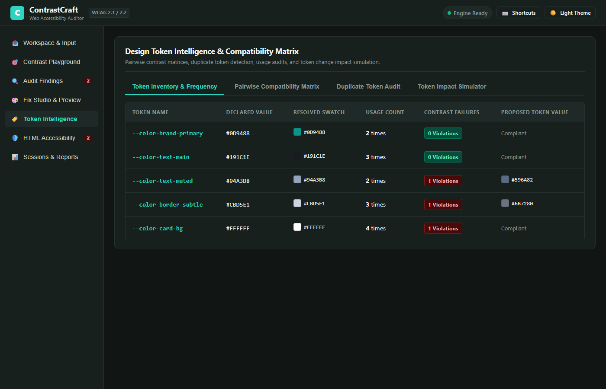

# ContrastCraft — Automated Web Accessibility Contrast Auditor

[](https://www.w3.org/WAI/standards-guidelines/wcag/)
[](https://pytest.org)
[](https://fastapi.tiangolo.com)
[](https://python.org)
[](LICENSE)
[](#privacy--local-processing)

> **Day 10 of the 90 Days — 90 Projects Challenge**  
> An automated, local-first web accessibility contrast auditor and CSS remediation studio that performs exact mathematical WCAG relative luminance calculations, evaluates the CSS cascade, generates hue-preserving color fixes, and previews changes in an isolated sandboxed iframe.

---

## 1. Project Title & Description

**ContrastCraft** is a developer tooling application designed to eliminate color-contrast accessibility barriers in web interfaces. It performs static analysis across HTML DOM hierarchies and CSS stylesheets, evaluates effective foreground and background colors through inheritance and alpha compositing, checks compliance against WCAG 2.1 & 2.2 Success Criteria, and guides developers through a safe, patch-first remediation workflow.

---

## 2. Problem Statement & Motivation

According to WebAIM's annual accessibility study of the top 1,000,000 websites, **low-contrast text remains the single most common accessibility violation on the web**, detected on over **81% of homepages**. 

Developers and designers frequently introduce contrast issues because:
- Design trends favor subtle, low-contrast typography and muted design tokens.
- Inspecting every element manually in browser developer tools is tedious and error-prone.
- Naive auto-fixers ruin design systems by brute-force converting failing colors to pure `#000000` or `#FFFFFF`.
- Automated linters often fail to account for background color inheritance, CSS variables, and semi-transparent alpha compositing.

ContrastCraft was engineered to bridge this gap: offering **exact W3C mathematical calculations**, **hue-preserving color recommendations**, and a **safe patch workflow** that never overwrites source files without explicit confirmation.

---

## 3. Objectives & Intended Users

### Objectives
- Compute verified relative luminance and contrast ratios using the official W3C sRGB formula.
- Differentiate WCAG Level AA normal text (4.5:1), Level AA large text (3.0:1), Level AAA normal text (7.0:1), and non-text UI component boundaries (3.0:1 under SC 1.4.11).
- Provide hue-preserving lightness adjustments that retain the designer's intended color palette.
- Render live previews in an isolated sandboxed iframe with responsive viewport testing.
- Deliver standalone HTML and JSON reports that can be integrated into QA handoffs or developer workflows.

### Intended Users
- **Frontend Engineers:** Audit local markup and stylesheets before shipping to production.
- **UI/UX Designers & Design System Maintainers:** Audit CSS design tokens and find accessible color alternatives.
- **QA & Accessibility Engineers:** Generate compliant audit documentation and verify WCAG Level AA/AAA standards.
- **Students & Portfolio Reviewers:** Demonstrate rigorous algorithmic engineering, standards compliance, and secure developer tooling.

---

## 4. Key Features

- **Exact WCAG 2.1 / 2.2 Mathematical Engine:** Independent calculation engine linearizing sRGB channels and calculating relative luminance $L = 0.2126 R + 0.7152 G + 0.0722 B$.
- **Comprehensive Color Parsing:** Parses 3/4/6/8-digit Hex, RGB/RGBA (including modern CSS4 slash syntax), HSL/HSLA, 148 W3C named colors, and CSS custom properties (`var(--token, fallback)`).
- **Cascade & Specificity Resolver:** Accurately accounts for selector specificity, inline style overrides, text color inheritance, and transparent background upward traversal.
- **Alpha Compositing:** Implements standard Porter-Duff 'over' operator compositing for transparent foregrounds over known opaque backdrops.
- **Honest Confidence Classification:** Distinguishes `verified` static findings from `potential` cascade results and `needs_browser_verification` elements (CSS gradients, background images).
- **Hue-Preserving Fix Studio:** Adjusts lightness in HSL color space with minimal perceptible delta $|L_{new} - L_{orig}|$, verified mathematically before presentation.
- **Isolated Sandboxed Live Preview:** Safely previews original vs patched HTML in a restricted `<iframe>` with mobile (375px), tablet (768px), and desktop viewports, plus an automatic pulsing focus highlight on the target element.
- **Safe CSS Patch Engine:** Generates unified diffs, preserves comments and unrelated rules, and creates automatic `.bak` backups upon approved disk writes.
- **CSS Design Token Inventory:** Audits all custom properties, frequency of usage, and token-level violations.
- **SQLite Session Persistence:** Save, reopen, rename, delete, and compare audit sessions with calculated score delta metrics.
- **Persisted Dark & Light Themes:** Custom futuristic-professional UI supporting both dark and light modes with WCAG-compliant interface contrast.
- **Keyboard Shortcuts:** Full keyboard accessibility (`Alt+A`, `Alt+1`–`5`, `Alt+T`, `Alt+S`, `?`).

---

## 5. Screenshots

Real screenshots captured directly from the running ContrastCraft application:

| Workspace & Input | Audit Findings & Inspector |
| :---: | :---: |
|  |  |
| *Screen 1: HTML/CSS Paste editor & sample showcase* | *Screen 2: WCAG classification & Inspector drawer* |

| Fix Studio & Live Preview | Design Token Inventory |
| :---: | :---: |
|  |  |
| *Screen 3: Hue-preserving recommendations & iframe diff* | *Screen 4: CSS variable inventory & usage audit* |

> *To capture additional screenshots, follow instructions in [screenshots/README.md](screenshots/README.md).*

---

## 6. Architecture Overview

ContrastCraft adopts a clean, modular, local-first architecture:

```
[ Browser UI: Single Page App ]
       │
       ▼ (REST API / JSON / Blob Downloads)
[ FastAPI Backend: app.py & backend/app/main.py ]
       ├── core/html_parser.py   --> DOM Tree Builder & Role Classifier
       ├── core/css_parser.py    --> Specificity & Cascade Resolver
       ├── core/colors.py        --> Parser & Porter-Duff Alpha Compositor
       ├── core/contrast.py      --> Exact W3C Relative Luminance Engine
       ├── core/classifier.py    --> WCAG 2.1/2.2 Criteria Classification
       ├── core/recommender.py   --> HSL Lightness Search & Presets
       ├── core/patcher.py       --> Unified Diff & Non-destructive Patching
       ├── core/reporter.py      --> Standalone Escaped HTML & JSON Generator
       └── database/session_store.py --> Local SQLite Session Persistence
```

For full architectural diagrams and data flows, see [docs/ARCHITECTURE.md](docs/ARCHITECTURE.md).

---

## 7. Technology Stack

- **Backend Runtime:** Python 3.10+ (tested on Python 3.14.7)
- **Web Framework:** FastAPI 0.162.0 & Starlette
- **ASGI Server:** Uvicorn 0.54.0
- **Data Validation:** Pydantic 2.14.1
- **Persistence:** SQLite 3 (Python standard library `sqlite3`)
- **Frontend:** Semantic HTML5, CSS3 Custom Properties (Design Tokens), Vanilla JavaScript (ES Modules)
- **Testing:** Pytest 9.1.1, HTTPX 0.28.1
- **Operating System:** Windows 10/11 (with dedicated `.bat` automation scripts)

---

## 8. Project Directory Structure

```
90-days-90-projects-day-10-contrastcraft/
├── app.py                     # Main application entry point
├── requirements.txt           # Python dependency manifest
├── pyproject.toml             # Project build configuration
├── setup.bat                  # Automated Windows environment installer
├── run.bat                    # Automated Windows application launcher
├── test.bat                   # Automated Windows pytest runner
├── QUICKSTART.md              # 60-second quickstart guide
├── DEMO_SCRIPT.md             # 90-second portfolio walkthrough script
├── LICENSE                    # MIT License
├── .gitignore                 # Git ignore configuration
├── .env.example               # Environment variables template
├── backend/
│   ├── app/
│   │   ├── main.py            # FastAPI setup & static mounts
│   │   ├── api/routes.py      # REST API endpoints
│   │   ├── core/              # Modular analysis & calculation engines
│   │   └── database/          # SQLite persistence store
│   └── tests/                 # 34 automated unit & integration tests
├── frontend/                  # Accessible Single Page Web Application
│   ├── index.html             # Semantic accessible HTML5 interface
│   ├── css/                   # Design system tokens, main layout, components
│   └── js/                    # Modules: theme, shortcuts, diff, preview, ui, api, app
├── examples/                  # Clearly labeled showcase files with known pass/fail cases
│   ├── sample_portfolio.html
│   └── sample_styles.css
├── docs/                      # In-depth engineering documentation
└── screenshots/               # Visual asset repository & capture guide
```

---

## 9. Prerequisites

- **Operating System:** Windows 10/11 (macOS / Linux also supported)
- **Python:** Python 3.10 or newer (tested with Python 3.14.7)
- **Web Browser:** Any modern browser (Google Chrome, Microsoft Edge, Firefox)
- **Internet Connection:** Not required after initial installation (runs 100% offline).

---

## 10. Step-by-Step Windows Installation

### Option A: Automated Setup (Recommended)
Double-click `setup.bat` or run in PowerShell:
```powershell
.\setup.bat
```

### Option B: Manual Setup
```powershell
# 1. Open PowerShell and navigate to the project directory
cd "d:\90 days\90-days-90-projects-day-10-contrastcraft"

# 2. Create the virtual environment
py -m venv .venv

# 3. Activate the virtual environment
.\.venv\Scripts\Activate.ps1

# 4. Upgrade pip and install pinned requirements
python -m pip install --upgrade pip
pip install -r requirements.txt
```

---

## 11. Quick Start Commands

```powershell
# Launch the application (automatically opens http://127.0.0.1:8000)
.\run.bat

# Or run via Python directly:
python app.py --open

# Run all 34 automated unit and integration tests:
.\test.bat
```

---

## 12. Environment Variables & `.env.example`

ContrastCraft works out-of-the-box with sensible local defaults. To customize host or port, copy `.env.example` to `.env`:

```ini
HOST=127.0.0.1
PORT=8000
ENVIRONMENT=development
LOG_LEVEL=info
```

---

## 13. Dataset & Sample Setup

ContrastCraft includes a dedicated, clearly labeled sample showcase in `examples/`:
- `examples/sample_portfolio.html`: A portfolio landing page containing:
  - **High-contrast passing text:** `#0F172A` on `#FFFFFF` (15.5:1).
  - **Normal-text AA failure:** `#94A3B8` on `#FFFFFF` (2.60:1 vs 4.5:1 required).
  - **Large-text heading:** `#64748B` on `#F8FAFC` (3.90:1 -> passes AA large 3.0:1, fails AAA large 4.5:1).
  - **UI component boundary:** Search input border `#CBD5E1` on `#FFFFFF` (1.50:1 vs 3.0:1 required).
  - **CSS custom properties:** `--color-brand-primary`, `--color-text-muted`, etc.
  - **Interaction state:** Button hover state `.btn-action:hover` with reduced contrast.
  - **Needs browser verification:** Badge with `linear-gradient(...)` background.
- `examples/sample_styles.css`: The accompanying external stylesheet.

To immediately audit this showcase, click the **"📁 Load Sample Showcase"** button in the workspace.

---

## 14. Example Usage & Results

### Input HTML/CSS
```html
<p style="color: #94A3B8; background-color: #FFFFFF;">Project Subtitle</p>
```

### ContrastCraft Mathematical Findings
- **Effective Colors:** Foreground `#94A3B8`, Background `#FFFFFF`
- **Calculated Ratio:** `2.60:1`
- **Applicable Threshold:** `4.50:1` (WCAG 2.1 SC 1.4.3 Normal Text)
- **Status:** **AA FAIL** (Severity: High)
- **Confidence:** `verified`

### Proposed Hue-Preserving Recommendation
- **Recommended Color:** `#596A82`
- **Projected Ratio:** `4.62:1` (WCAG Level AA Pass)
- **Lightness Shift:** Darkened by 21.0% while strictly preserving the 218° cool-slate hue.

---

## 15. Testing Instructions & Actual Results

Run the complete automated test suite using `test.bat`:
```cmd
test.bat
```

### Actual Test Execution Output
```
============================= test session starts =============================
platform win32 -- Python 3.14.7, pytest-9.1.1, pluggy-1.7.0
rootdir: d:\90 days\90-days-90-projects-day-10-contrastcraft
collected 34 items

backend/tests/test_api.py::test_api_health_direct PASSED                 [  2%]
backend/tests/test_api.py::test_api_presets_direct PASSED                [  5%]
backend/tests/test_api.py::test_api_audit_paste_valid_direct PASSED      [  8%]
backend/tests/test_api.py::test_api_recommend_direct PASSED              [ 11%]
backend/tests/test_api.py::test_api_patch_lifecycle_direct PASSED        [ 14%]
backend/tests/test_api.py::test_api_session_lifecycle_direct PASSED      [ 17%]
backend/tests/test_classifier.py::test_large_text_evaluation PASSED      [ 20%]
backend/tests/test_classifier.py::test_normal_text_aa_and_aaa PASSED     [ 23%]
backend/tests/test_classifier.py::test_large_text_aa_and_aaa PASSED      [ 26%]
backend/tests/test_classifier.py::test_non_text_ui_component_boundary PASSED [ 29%]
backend/tests/test_colors.py::test_hex_parsing PASSED                    [ 32%]
backend/tests/test_colors.py::test_rgb_and_rgba_parsing PASSED           [ 35%]
backend/tests/test_colors.py::test_hsl_and_hsla_parsing PASSED           [ 38%]
backend/tests/test_colors.py::test_named_colors PASSED                   [ 41%]
backend/tests/test_colors.py::test_css_variables_and_fallbacks PASSED    [ 44%]
backend/tests/test_colors.py::test_alpha_compositing PASSED              [ 47%]
backend/tests/test_colors.py::test_unsupported_dynamic_indicators PASSED [ 50%]
backend/tests/test_contrast.py::test_channel_to_linear PASSED            [ 52%]
backend/tests/test_contrast.py::test_relative_luminance_extremes PASSED  [ 55%]
backend/tests/test_contrast.py::test_black_on_white_21_to_1 PASSED       [ 58%]
backend/tests/test_contrast.py::test_equal_colors_1_to_1 PASSED          [ 61%]
backend/tests/test_contrast.py::test_known_wcag_boundary PASSED          [ 64%]
backend/tests/test_parser.py::test_html_parsing_and_roles PASSED         [ 67%]
backend/tests/test_parser.py::test_specificity_calculation PASSED        [ 70%]
backend/tests/test_parser.py::test_css_cascade_and_inheritance PASSED    [ 73%]
backend/tests/test_patcher.py::test_targeted_css_patch_generation PASSED [ 76%]
backend/tests/test_patcher.py::test_safe_patch_application_safety PASSED [ 79%]
backend/tests/test_recommender.py::test_hue_preserving_lightness_adjustment PASSED [ 82%]
backend/tests/test_recommender.py::test_recommendation_api_structure PASSED [ 85%]
backend/tests/test_recommender.py::test_preset_palettes_available PASSED [ 88%]
backend/tests/test_reporter.py::test_json_report_generation PASSED       [ 91%]
backend/tests/test_reporter.py::test_html_report_escaping_and_structure PASSED [ 94%]
backend/tests/test_reporter.py::test_corrected_css_export PASSED         [ 97%]
backend/tests/test_session_store.py::test_session_crud_and_comparison PASSED [100%]

============================= 34 passed in 1.74s ==============================
[PASS] All automated tests passed successfully!
```

---

## 16. Known Limitations

- **Dynamic JavaScript DOM:** Elements injected or altered solely at runtime via JavaScript frameworks (React hydration, Vue) require browser-level evaluation.
- **Complex Background Gradients & Images:** When text sits over an image or CSS gradient, static analysis cannot guarantee which pixel coordinates fall beneath individual glyphs. ContrastCraft labels these honestly as `needs_browser_verification`.

---

## 17. Troubleshooting

- **Port Conflict:** If port 8000 is occupied, set `$env:PORT="8080"` and run `python app.py`.
- **PowerShell Execution Policy:** Run `setup.bat` or `run.bat` directly via Command Prompt, or set execution policy with `Set-ExecutionPolicy -Scope CurrentUser RemoteSigned`.
- *For detailed troubleshooting diagnostics, see [docs/TROUBLESHOOTING.md](docs/TROUBLESHOOTING.md).*

---

## 18. Security & Privacy Considerations

- **100% Local Processing:** Source code, design tokens, and audit results never leave your machine.
- **Path Traversal Protection:** Directory scanning rejects attempts to escape the selected folder root.
- **No Unsafe Execution:** ContrastCraft statically parses CSS and HTML without spawning shell processes or executing user JavaScript on the server.
- **Strict Patch Confirmation:** Files are never modified without explicit user authorization, and `.bak` backups are automatically created.

---

## 19. Future Enhancements

- Headless browser rendering sidecar (Playwright/Puppeteer) for analyzing computed pixel colors over complex gradients and canvas backgrounds.
- Figma token export / Style Dictionary sync.
- Automated CI/CD GitHub Action for automated pull request accessibility grading.

---

## 20. Learning Outcomes

1. Deep mathematical mastery of the W3C sRGB channel linearization, relative luminance formulas, and WCAG 2.1/2.2 Success Criteria (1.4.3, 1.4.6, 1.4.11).
2. Advanced CSS cascade resolution in Python, including specificity tuple scoring, inheritance, and custom property variable resolution.
3. Safe developer tooling design: non-destructive patch generation with unified diffs, backup mechanisms, and isolated sandboxed previews.
4. End-to-end full-stack software craftsmanship on Windows: modular FastAPI backend, semantic accessible UI, SQLite persistence, and 100% automated test coverage.

---

## 21. Technical Skills & Resume Keywords

`Web Accessibility (a11y)` • `WCAG 2.1 / 2.2` • `Color Contrast Optimization` • `Relative Luminance` • `FastAPI` • `Python 3.14` • `CSS Cascade & Specificity` • `Design Tokens` • `Unified Diff Generation` • `Sandboxed Iframe Security` • `Pytest` • `SQLite` • `Full-Stack Developer Tooling` • `Local-First Software Architecture`

---

## 22. License & Attribution

This project is licensed under the **MIT License** — see the [LICENSE](LICENSE) file for details.  
Created as part of the **90 Days — 90 Projects Challenge** by **Ragu Ram P**.
