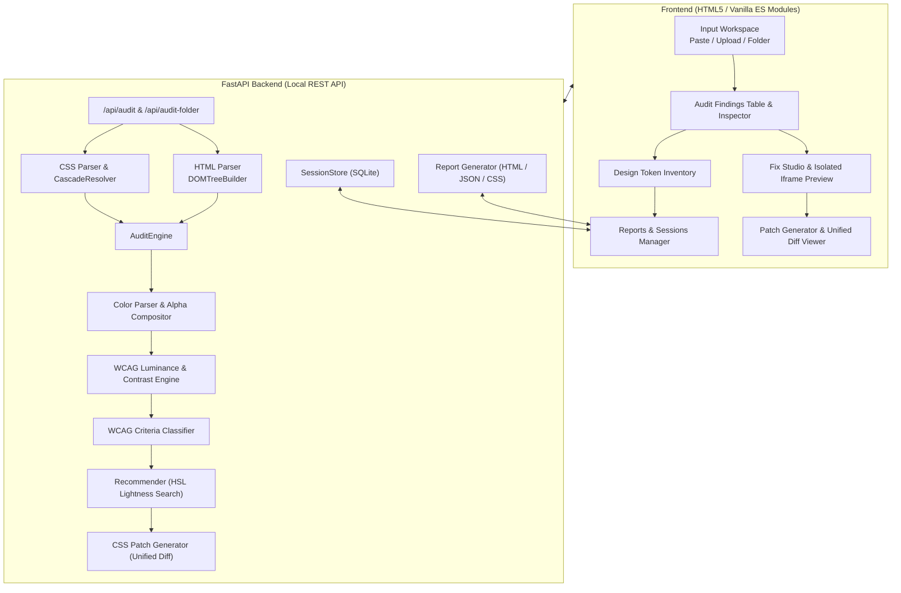

# Architecture & Technical Design — ContrastCraft

## 1. System Architecture Diagram



---

## 2. Component Breakdown

### 2.1 Backend Core Modules (`backend/app/core/`)

1. **`colors.py`**:
   - `RGBAColor` dataclass representing red, green, blue ($0 \dots 255$) and alpha ($0.0 \dots 1.0$).
   - Comprehensive dictionary of 148 standard W3C CSS named colors.
   - Robust parser supporting 3/4/6/8-digit hexadecimal, RGB/RGBA (both comma and CSS4 slash syntax), HSL/HSLA (including degree, radian, turn units), and custom properties `var(--token, fallback)`.
   - Alpha compositing implementing standard Porter-Duff 'over' blending operator:
     $$C_{composite} = \frac{C_{fg} \cdot a_{fg} + C_{bg} \cdot a_{bg} \cdot (1 - a_{fg})}{a_o}$$

2. **`contrast.py`**:
   - Implements the official W3C sRGB channel linearization:
     $$c_{lin} = \begin{cases} \frac{c}{12.92} & \text{if } c \le 0.04045 \\ \left(\frac{c + 0.055}{1.055}\right)^{2.4} & \text{if } c > 0.04045 \end{cases}$$
   - Calculates relative luminance:
     $$L = 0.2126 \cdot R_{lin} + 0.7152 \cdot G_{lin} + 0.0722 \cdot B_{lin}$$
   - Computes contrast ratio between effective foreground and background:
     $$CR = \frac{L_{lighter} + 0.05}{L_{darker} + 0.05}$$

3. **`classifier.py`**:
   - Classifies ratios against WCAG 2.1 / 2.2 Success Criteria:
     - SC 1.4.3 Contrast (Minimum) (Level AA): Normal text $\ge 4.5:1$, Large text $\ge 3.0:1$.
     - SC 1.4.6 Contrast (Enhanced) (Level AAA): Normal text $\ge 7.0:1$, Large text $\ge 4.5:1$.
     - SC 1.4.11 Non-text Contrast (Level AA): UI component boundaries & icons $\ge 3.0:1$.
   - Large text evaluation based on CSS units ($\ge 24\text{px} / 18\text{pt}$ regular or $\ge 18.66\text{px} / 14\text{pt}$ bold).
   - Assigns honest confidence ratings (`verified`, `potential`, `needs_browser_verification`).

4. **`html_parser.py`**:
   - Resilient DOM tree builder using Python's standard library `html.parser.HTMLParser`.
   - Extracts semantic element roles (`heading`, `button`, `link`, `input`, `text`), inline styles, line numbers, and embedded style blocks.

5. **`css_parser.py`**:
   - Parses stylesheet declarations, selector specificity tuples `(inline, ID, class/pseudo, tag)`, and CSS custom properties (`:root`).
   - Implements `CascadeResolver` to handle specificity sorting, inheritance (text color inheriting down the tree), and transparent background upward traversal.

6. **`recommender.py`**:
   - Converts failing colors to HSL color space $(H, S, L)$ to preserve original aesthetic hue and saturation.
   - Executes an iterative lightness search to locate the minimal perceptible delta $|L_{new} - L_{orig}|$ that satisfies the target ratio.
   - Provides Level AAA enhanced targets and high-contrast anchors.

7. **`patcher.py`**:
   - Generates surgical, non-destructive declaration replacements and unified diffs.
   - Guarantees source file preservation with `.bak` backups created prior to disk writes.

8. **`reporter.py`**:
   - Generates machine-readable JSON reports and self-contained, print-friendly standalone HTML audit documents with full HTML escaping to prevent XSS.

---

## 3. Database Schema (SQLite)

Local session persistence uses SQLite (`contrastcraft.db`):

```sql
CREATE TABLE IF NOT EXISTS audit_sessions (
    id TEXT PRIMARY KEY,
    name TEXT NOT NULL,
    created_at TEXT NOT NULL,
    updated_at TEXT NOT NULL,
    input_type TEXT NOT NULL,
    html_content TEXT,
    css_content TEXT,
    summary_json TEXT NOT NULL,
    findings_json TEXT NOT NULL,
    tokens_json TEXT NOT NULL
);
```

---

## 4. Security & Safety Model

1. **Path Traversal Protection:** Local folder scanning resolves paths strictly against target directories, rejecting directory traversal attempts (`..`).
2. **Resource Boundaries:** Hard limits on maximum analyzed files (50 files by default) and content lengths (5MB max) prevent uncontrolled memory consumption.
3. **No Code Execution:** ContrastCraft parses HTML and CSS statically. It never runs untrusted JavaScript on the backend or spawns shell processes.
4. **Sandboxed Iframe:** Live previews render inside an iframe configured with `sandbox="allow-same-origin allow-scripts"`, preventing untrusted DOM code from accessing the parent application.
5. **XSS Prevention:** All user-supplied selectors, texts, and attributes are sanitized with `html.escape()` prior to injection in generated HTML reports.
